# What makes a road collision serious? Great Britain, 2021–2025

**Hirishikesh Parthasarathy** · MSc Artificial Intelligence, University of Edinburgh 
Data: Department for Transport STATS19 open data (collisions, vehicles, casualties) · Code: [`notebooks/uk_road_safety_eda.ipynb`](../notebooks/uk_road_safety_eda.ipynb)

---

## Executive summary

Over 2021–2025, police in Great Britain recorded **513,801 injury collisions**, involving **937,265 vehicles** and **652,821 casualties**, of whom **8,033 died**. This report asks which factors most strongly predict how severe a collision is, and how the pattern has changed.

**How severe a collision is depends mostly on *who* is involved and *what kind of road* it happens on. Weather matters little.**

1. **Vulnerable road users carry half the deaths.** Pedestrians, cyclists, motorcyclists and e-scooter riders make up 40% of casualties but 51% of fatalities. A motorcycle in a collision multiplies the odds of a killed-or-seriously-injured (KSI) outcome by 2.9.
2. **Rural roads are where people die.** Rural roads see 33% of collisions but 63% of fatal ones. 60 mph roads, almost all rural single carriageways, have the highest KSI rate: 36.5%, against 23.6% at 30 mph.
3. **Night-time crashes are up to five times as deadly.** There are 41 deaths per 1,000 collisions at 04:00, against 7.9 at 08:00. Collisions in darkness without street lighting are 3.8 times as likely to be fatal as daylight collisions.
4. **Older road users, not young drivers, face the steepest severity gradient.** Casualties aged 75+ die at 42 per 1,000, almost four times the rate for 17–24s. Once the road and vehicle mix is controlled for, drivers aged 75+ raise KSI odds by 1.6×; drivers aged 17–24 raise them by only 1.06×.
5. **Collisions are flat, but they are getting more severe.** Collisions changed by +0.4% from 2021 to 2025 and deaths by −1.3%, but severity-adjusted KSI casualties rose **13.3%**. About a fifth of the recorded rise comes from police forces switching to injury-based severity reporting; the rest is real.

**Priority actions:** treat rural 60 mph single carriageways first, protect vulnerable road users (more 20 mph zones, segregated cycling, motorcycle safety), and track progress on DfT's severity-adjusted figures.

---

## 1. Data and method

| | |
|---|---|
| **Source** | DfT *Road Safety Data*, "last 5 years" files: collisions, vehicles and casualties, joined on `collision_index`. Codes are decoded with DfT's 2025 data guide. |
| **Coverage** | Personal-injury collisions on public roads reported to police in England, Scotland and Wales, 1 Jan 2021 – 31 Dec 2025. |
| **Join integrity** | Every casualty and vehicle matches a collision, and every collision has at least one casualty. There are 1.27 casualties and 1.82 vehicles per collision. |
| **Missing data** | Under 5% for every road-environment field. Driver age is missing for 15% of vehicles and journey purpose for 67%, so journey purpose is excluded. |

Three decisions shape the analysis.

**Unit of analysis.** Road-environment questions are answered per *collision* and people questions per *casualty*. The earlier draft of this project merged casualties onto collisions and labelled casualty rows with *collision* severity, which double-counts multi-casualty crashes. That has been corrected.

**Severity adjustment.** Police forces are moving to the injury-based CRASH system. Its share of collisions rose from **49.6% in 2021 to 86.5% in 2025** (Figure 1). CRASH classifies more injuries as *serious* than officer judgement does. DfT publishes, for each record, the probability that it would be *serious* under injury-based reporting. Every KSI figure in this report uses that probability: `KSI = fatal + P(serious)`.

**Severity, not risk.** STATS19 records crashes, not traffic. Every rate here is *the severity of a collision, given that it happened*. We can say a 60 mph crash is more likely to be serious. Without traffic-volume data we cannot say a 60 mph road is more dangerous per mile driven.

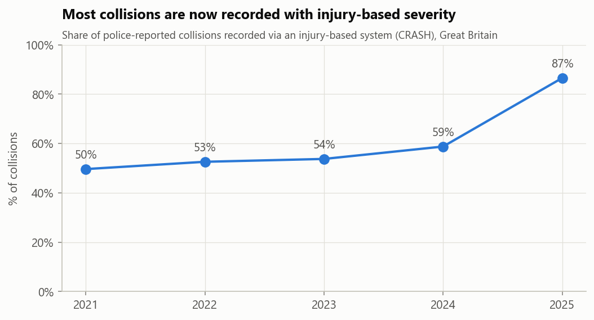
*Figure 1. Share of collisions recorded under injury-based severity reporting.*

---

## 2. How the picture changed, 2021–2025

| Year | Collisions | Casualties | Fatalities | KSI casualties (adjusted) | KSI share of collisions: recorded | KSI share: adjusted |
|---|---:|---:|---:|---:|---:|---:|
| 2021 | 101,087 | 128,209 | 1,558 | 26,397 | 22.5% | 23.9% |
| 2022 | 106,004 | 135,480 | 1,711 | 28,926 | 23.5% | 24.7% |
| 2023 | 104,258 | 132,977 | 1,624 | 28,973 | 23.9% | 25.1% |
| 2024 | 100,927 | 128,272 | 1,602 | 28,876 | 24.8% | 26.0% |
| 2025 | 101,525 | 127,883 | 1,538 | 29,918 | 26.2% | 26.8% |

Collision and fatality counts are essentially flat. The **share of collisions that kill or seriously injure** has risen every year (Figure 2). The recorded rise is 3.7 percentage points and the adjusted rise is 2.9, so roughly a fifth of the headline deterioration is a recording artefact. In the regression (section 6), 2025 collisions still have 1.17× the KSI odds of 2021 collisions with road, light, weather, vehicle and road-user mix held constant.

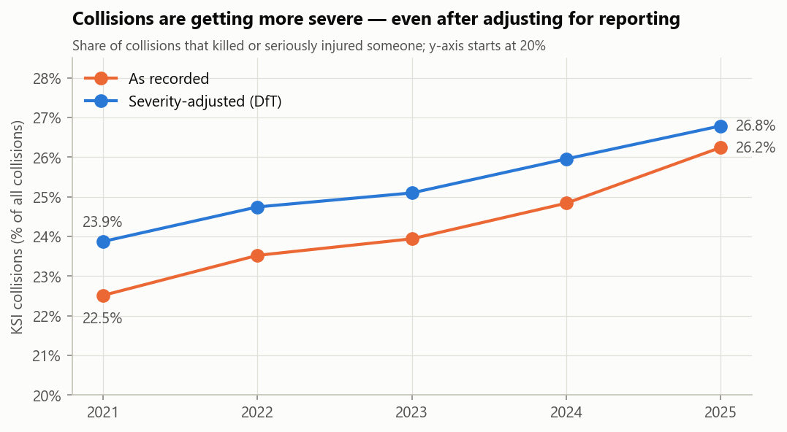
*Figure 2. Recorded vs severity-adjusted KSI share of collisions.*

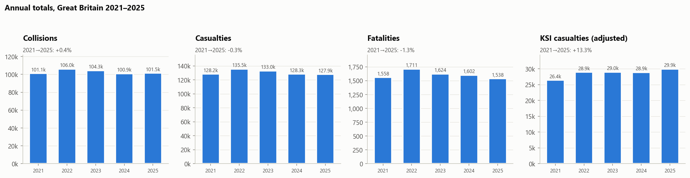
*Figure 3. Annual totals.*

Collisions peak in **November** and are lowest in **February** (Figure 4). The busiest hour of the week is **Friday 15:00–16:00** (Figure 5).

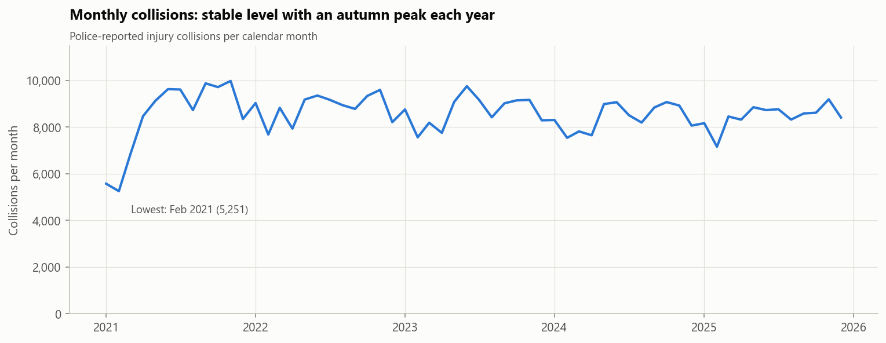
*Figure 4. Collisions per month.*

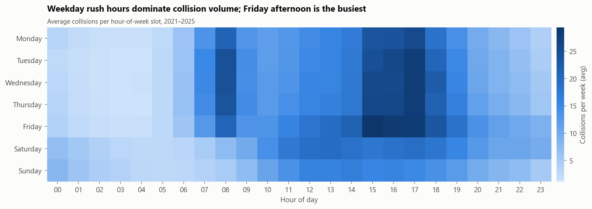
*Figure 5. Average collisions per hour-of-week.*

---

## 3. When: volume peaks by day, deaths peak at night

Collision *volume* follows traffic: weekday peaks at 08:00 and 15:00–18:00. *Severity* runs the other way (Figure 6). The fatality rate climbs from **7.9 per 1,000 collisions at 08:00 to 41.1 at 04:00**. Night crashes involve higher speeds, emptier roads, darkness, fatigue and, likely, impairment. The night effect survives controls for light and road type (odds ratio 1.44 for 00:00–05:59).

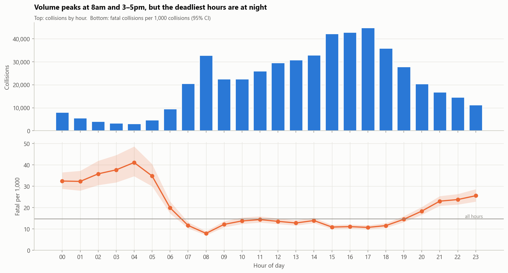
*Figure 6. Collisions by hour (top) and fatal collisions per 1,000 (bottom, 95% CI).*

---

## 4. Where: rural, fast and dark

**Speed limit.** Severity rises steadily up to 60 mph (Figure 7). The fatality rate is 4.7 per 1,000 at 20 mph, 8.7 at 30, 18.0 at 40, 28.9 at 50 and 38.4 at 60. 70 mph roads (motorways and dual carriageways) are less severe than 60 mph roads despite higher speeds, because they separate opposing traffic and have no at-grade junctions.

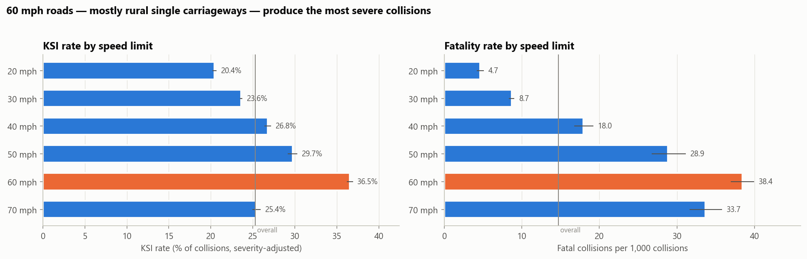
*Figure 7. KSI and fatality rate by speed limit (95% CI).*

**Urban vs rural.** The rural KSI rate is 30.9%, against 22.5% in urban areas, and the fatality rate is 28.3 per 1,000 against 8.0. Rural roads carry a third of collisions but almost two-thirds of fatal ones. Rural is worse than urban at *every* speed limit (Figure 8), so this is not only a speed-limit effect.

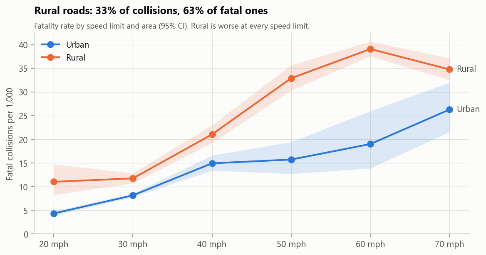
*Figure 8. Fatality rate by speed limit, urban vs rural.*

**Light, weather and surface.** Darkness without street lighting gives 45.5 deaths per 1,000 collisions, against 14.7 where roads are lit and 12.1 in daylight. Rain does not raise the fatality rate, and snow and ice lower it, because traffic slows. Fog and wet roads look worse in the raw rates (Figure 9) but mostly because they coincide with darkness and rural roads. In the model, fog is not significant and a wet surface adds only 7%. Fine weather accounts for 81% of collisions simply because most days are fine. That does not show behaviour "causes" crashes, as the earlier draft claimed.

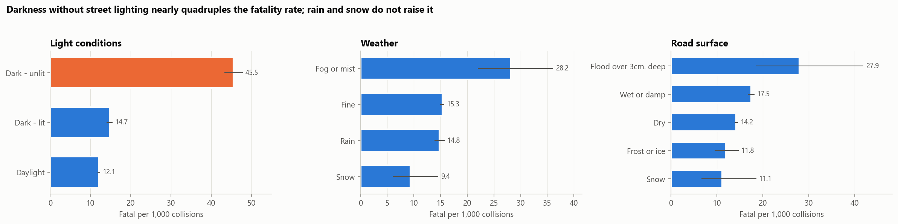
*Figure 9. Fatality rate by light, weather and road surface (95% CI).*

**Geography.** Collisions cluster in cities and along the strategic road network (Figure 10). Severity varies more than twofold across police forces (Figure 11), from 16.4% KSI in the Metropolitan Police area to 44.5% in North Wales. Rural Wales and Scotland have the highest rates. Part of the remaining variation between forces reflects local recording practice, which the DfT adjustment reduces but does not remove.

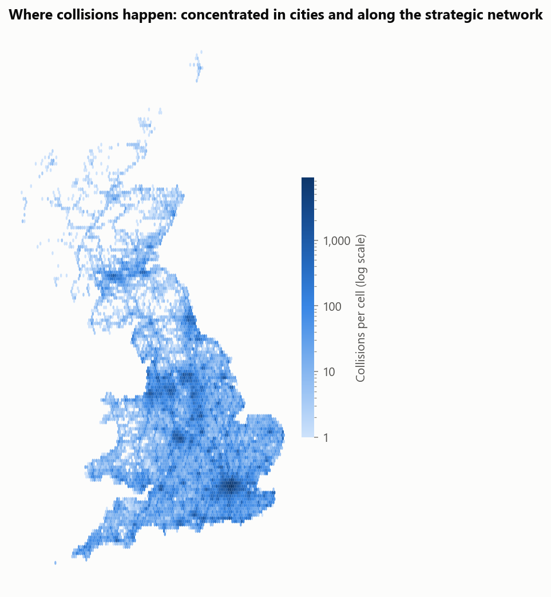
*Figure 10. Collision density, 2021–2025.*

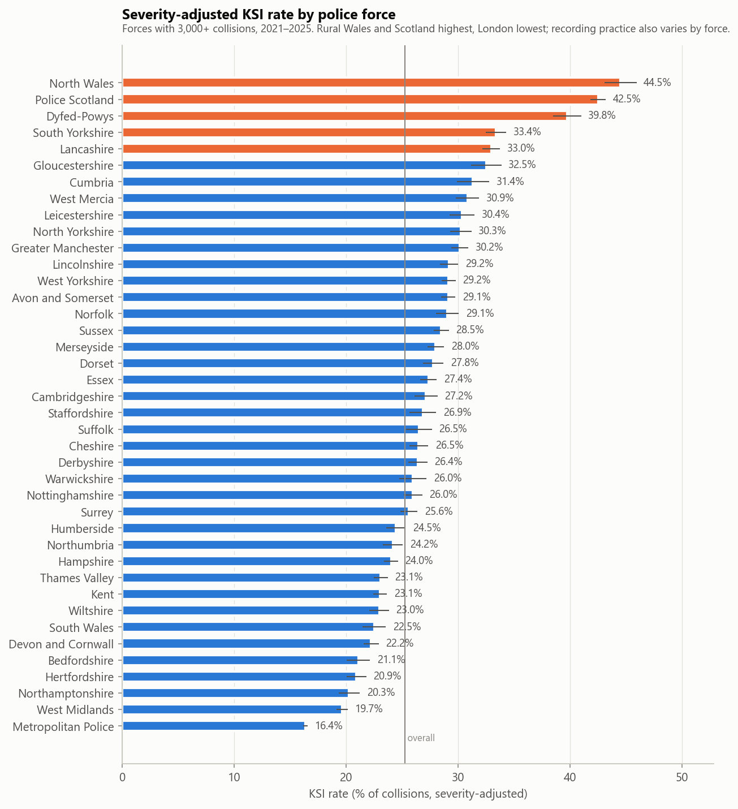
*Figure 11. Severity-adjusted KSI rate by police force.*

---

## 5. Who: vulnerable road users and older people

**Road users.** Car occupants are 55% of casualties but only 15.5% of them are KSI. For motorcyclists the figure is 35.4%, e-scooter riders 32.1%, pedestrians 32.0% and cyclists 26.3% (Figure 12). Pedestrians are 14.6% of casualties but 24.0% of deaths; motorcyclists are 12.5% of casualties and 21.2% of deaths.

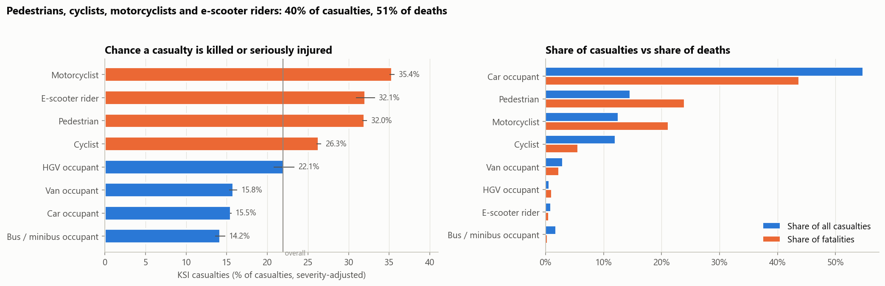
*Figure 12. KSI rate by road-user type, and share of casualties vs share of deaths.*

**Casualty age.** 25–34s are the largest casualty group, followed by 17–24s, but the chance of dying rises steeply with age (Figure 13). It is 11.0 per 1,000 casualties at 17–24, 22.6 at 65–74 and **42.3 at 75+**. The earlier draft's claim that young adults are "over-represented in fatal casualties" mixed up volume with severity. Young people are more often *involved*; older people are more likely to *die* when involved.

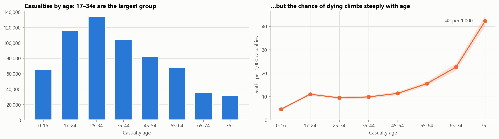
*Figure 13. Casualties by age and deaths per 1,000 casualties.*

**Driver age.** Among motor-vehicle drivers, collisions involving drivers aged 75+ are the most severe, with a 31.6% KSI rate against 22.8% for 25–34s (Figure 14). 17–24s sit at 26.4%, above average but well below older drivers.

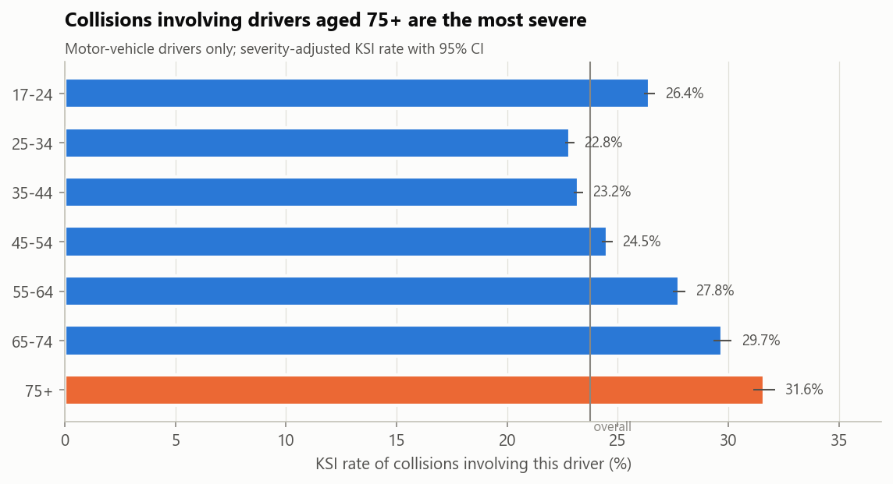
*Figure 14. KSI rate of collisions by age of the motor-vehicle driver.*

**E-scooters.** E-scooter rider casualties are stable at 1,100–1,230 a year, but the share killed or seriously injured rose from 30.1% in 2021 to 36.3% in 2025.

---

## 6. Which factors matter most?

With half a million records, every chi-square test is significant (p < 0.001), so p-values cannot rank factors. Ranked by **effect size (bias-corrected Cramér's V)**, area type (0.105), motorcycle involvement (0.100), speed limit (0.090), number of vehicles (0.088) and pedestrian involvement (0.082) lead. Weather (0.016), driver aged 17–24 (0.012) and road surface (0.011) come last (Figure 15).

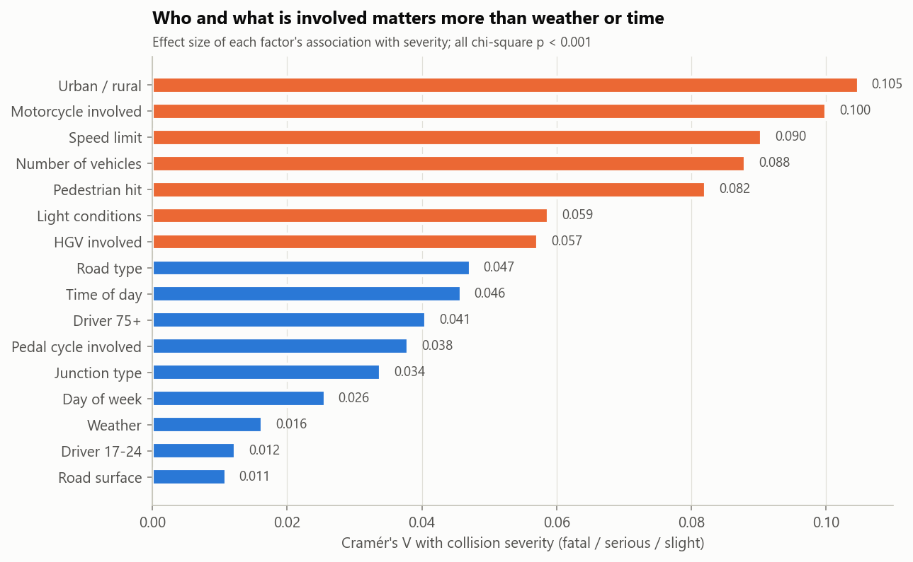
*Figure 15. Effect size of each factor's association with collision severity.*

These factors overlap: rural roads are faster, darker and carry more motorcycles. A **fractional logistic regression** separates them. It is fitted to the severity-adjusted KSI probability of each of 513,706 collisions, with robust standard errors, and estimates each factor's effect with all the others held constant (Figure 16).

| Raises KSI odds | Odds ratio | Lowers KSI odds | Odds ratio |
|---|---:|---|---:|
| Motorcycle involved | 2.93 | Slip road (vs single carriageway) | 0.66 |
| E-scooter involved | 2.64 | One-way street | 0.67 |
| Pedal cycle involved | 2.49 | Roundabout | 0.69 |
| Pedestrian hit | 2.03 | 20 mph limit (vs 30 mph) | 0.74 |
| 60 mph limit (vs 30 mph) | 1.81 | Dual carriageway | 0.82 |
| Single-vehicle collision (vs two) | 1.63 | Ice or snow on road | 0.89 |
| Driver aged 75+ | 1.60 | Raining | 0.92 |
| Night, 00:00–05:59 (vs daytime) | 1.44 | AM peak, 06:00–09:59 | 0.93 |
| HGV involved | 1.33 | | |
| Rural (vs urban) | 1.29 | | |

All odds ratios shown have 95% confidence intervals that exclude 1. On a 20% hold-out sample the model's AUC is **0.67**: road and vehicle context explains part of severity, but much depends on things STATS19 does not record, such as actual speed, seatbelt use, impact angle and emergency response.

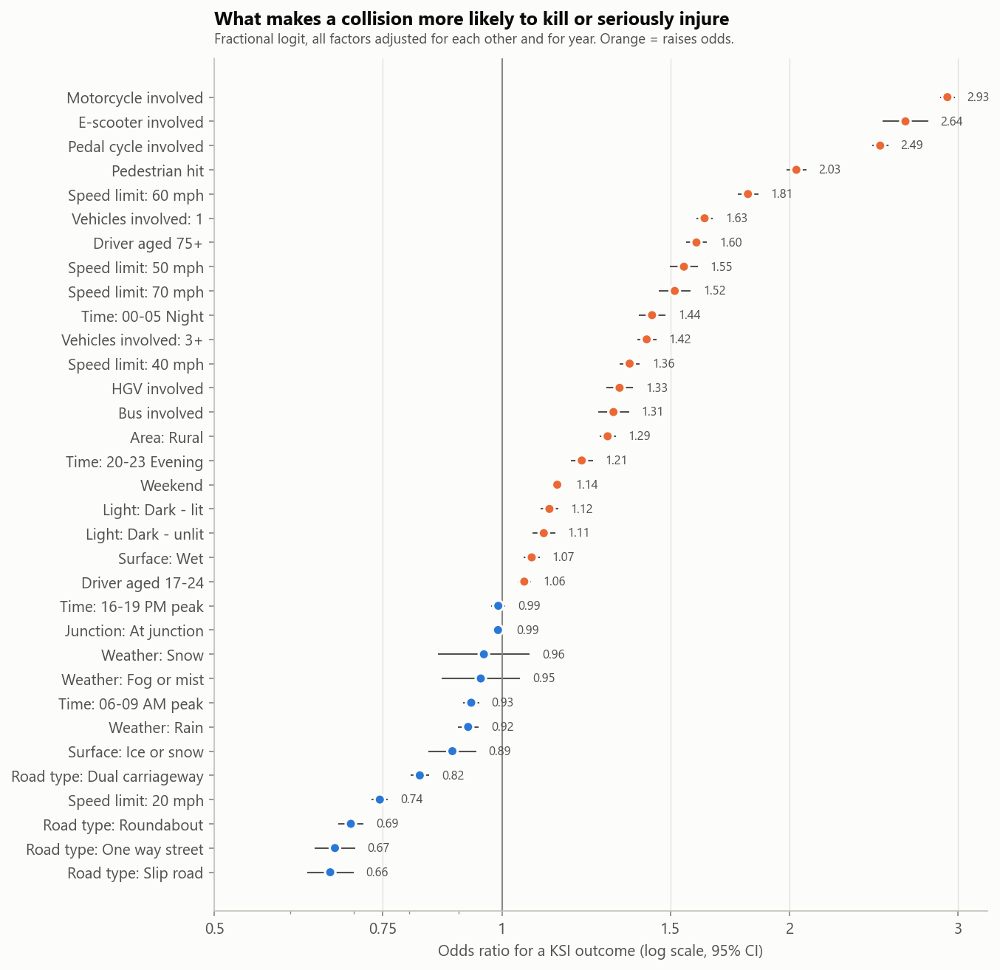
*Figure 16. Adjusted odds ratios for a KSI outcome (95% CI, log scale).*

---

## 7. Recommendations

| Priority | Action | Evidence |
|---|---|---|
| 1 | **Make rural 60 mph single carriageways safer.** Use route-level speed-limit reviews, average-speed enforcement, junction and bend treatments, and run-off-road protection. | 63% of fatal collisions are rural. The 60 mph odds ratio is 1.81 and single-vehicle crashes have an odds ratio of 1.63. |
| 2 | **Protect vulnerable road users.** Extend 20 mph limits where people walk and cycle, build segregated cycle routes, fit motorcycle-friendly barriers and invest in rider training. | Vulnerable road users are 51% of deaths. 20 mph has an odds ratio of 0.74. |
| 3 | **Focus night-time enforcement and lighting** on high-casualty rural routes. | Night fatality rate is up to 5× the morning rate. Unlit darkness is 3.8× daylight. |
| 4 | **Design for older road users.** Longer crossing times and voluntary driving assessments at 75+. | 75+ casualties die at 42 per 1,000. Drivers aged 75+ have an odds ratio of 1.60. |
| 5 | **Watch e-scooter severity.** | KSI share of e-scooter casualties rose from 30% to 36%. |
| 6 | **Report KSI on DfT's severity-adjusted basis** until every force uses injury-based reporting. | About a fifth of the recorded KSI rise is a reporting artefact. |

## 8. Limitations and next steps

- **No exposure data.** Joining DfT traffic counts (vehicle-miles by road class and region) would turn severity rates into risk per mile.
- **Police-reported collisions only.** Slight injuries and cyclist-only collisions are under-recorded.
- **Observational data.** The odds ratios are adjusted associations, not causal effects. Contributory factors (speeding, impairment) are published by DfT separately and are not in this open extract.
- **Modelling.** A gradient-boosted model with SHAP values would capture interactions such as rural × night × motorcycle. A spatial model by local authority would support targeting.

---

*Reproduce: `python download_data.py && python -m src.prepare_data`, then run the notebook. All figures in this report are generated by the notebook; headline numbers are saved to [`reports/key_numbers.json`](key_numbers.json).*
